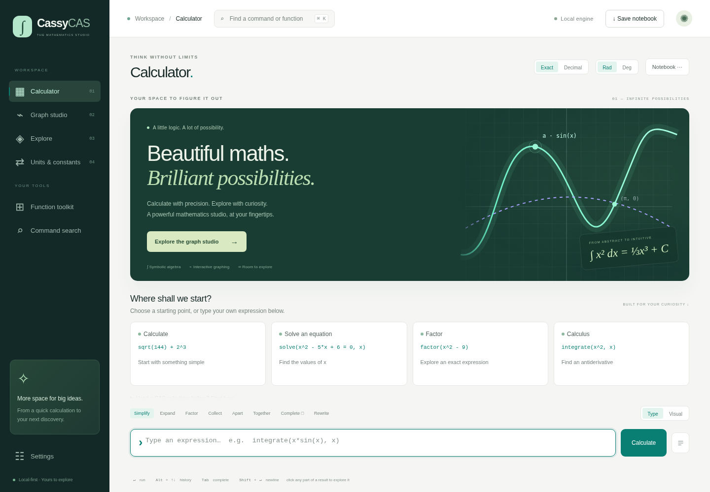
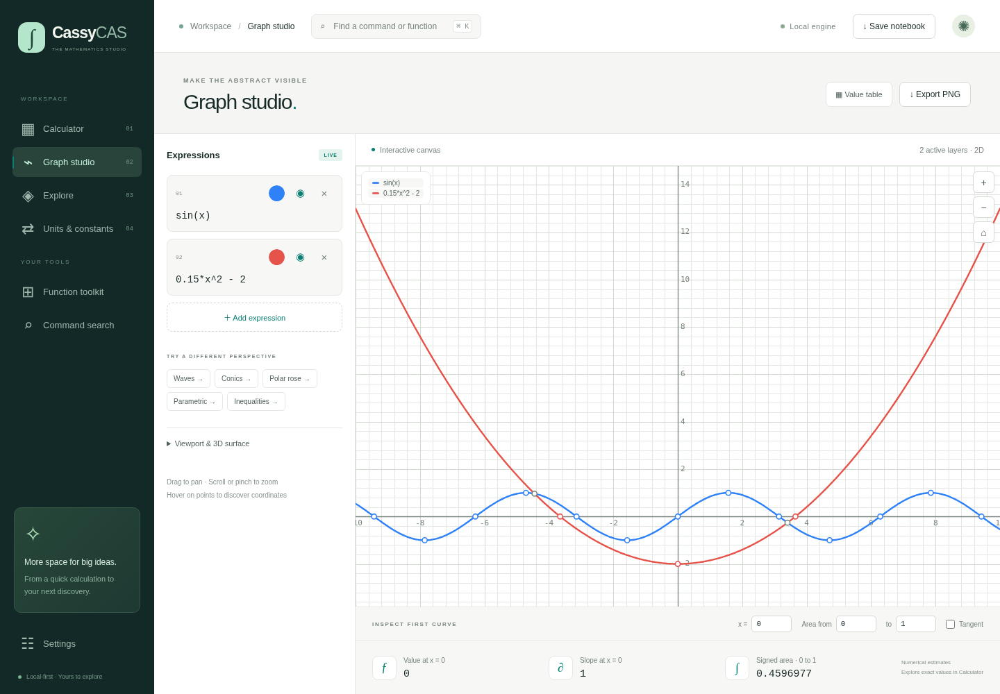
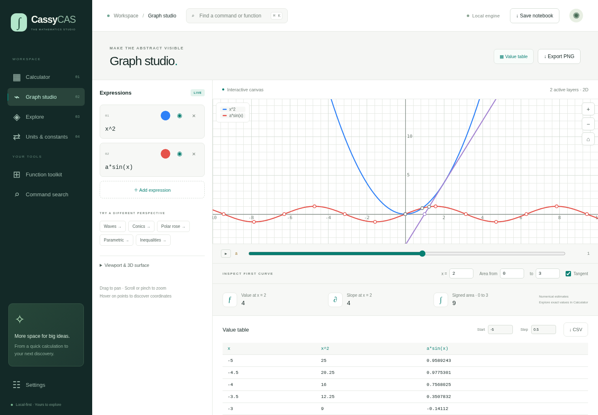
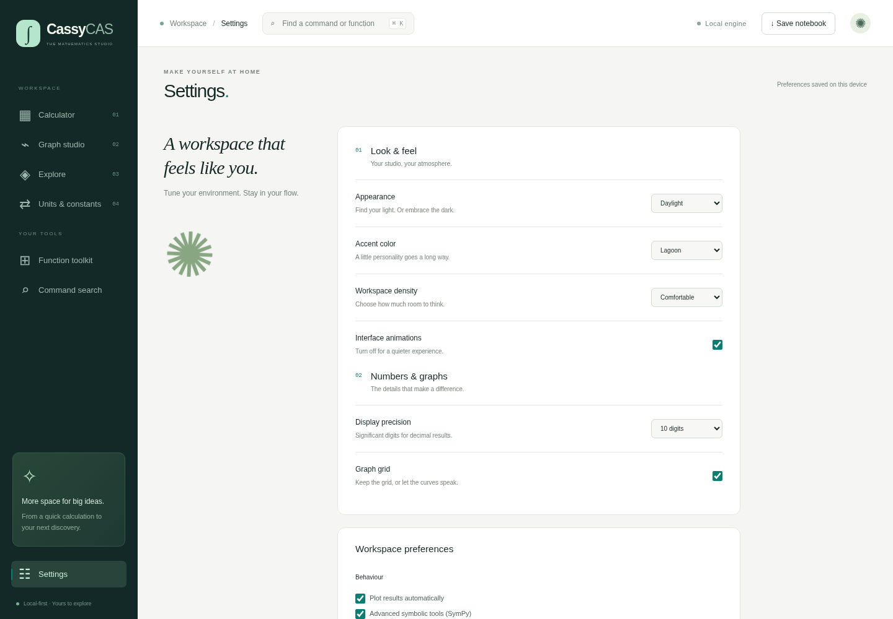
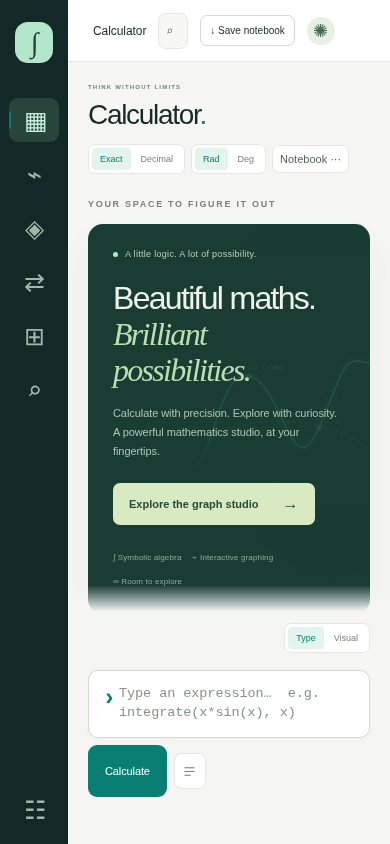

# CassyCAS studio: UI and interaction audit

The redesign keeps a local HTML entry point and separates the workspace into Calculator, Graph studio, Explore, Units & constants, and Settings.

## Visual review

Screenshots are captured with Playwright from the actual root `index.html`, with the browser offline. Viewports: 1440 × 1000 and 390 × 844. The audit covers the four redesigned sections, dark mode, and an active graph-analysis session. `npm run audit:ui` regenerates the captures in `/tmp/cassycas-audit`.

Issues found and corrected during visual inspection:

- The welcome panel inherited centered text from the old interface. The hero now has a deliberate left-aligned text column and a separate graph illustration.
- The previous header crowded export, sharing, mode, and appearance controls together. Navigation, calculator modes, notebook actions, and settings now have separate homes.
- The dark theme's original teal accent lacked contrast. Midnight mode uses brighter accent variants.
- Some working labels and example expressions were too small. Their sizes were increased, and expression visibility/color/remove controls received larger hit areas.
- Mobile calculation controls wrapped an unnecessary clear button onto its own row. Clearing now lives in the notebook menu.
- The mobile input competed with operation chips. Specialist operations remain in the Function toolkit, while the input stays available below the scrollable notebook.
- Canvas layers formerly had to be edited as one comma-separated string. Individual rows now expose their own controls and errors.

The scripted audit found no document-width overflow and no visible unnamed buttons at either tested size. Browser page-error capture was empty. This is a focused audit, not a claim of complete accessibility certification or coverage of every browser.

## Interaction checks

Automated tests exercise direct file opening without network access; arithmetic, factoring and solving; automatic graph updates; parameters; tangent and signed-area estimates; value-table generation and CSV download; hiding/showing layers; isolation of invalid expressions; saved graph expressions; settings persistence; and an empty Explore search.

For `x^2`, the inspector at x = 2 is checked against value 4 and slope 4. Signed area from 0 to 3 is checked against 9. The value table is checked against x = −5, y = 25.

Graph inspector results are numerical estimates using central differences and composite Simpson integration. Singularities and ill-conditioned functions can make those estimates unreliable; use the symbolic Calculator for exact work. Advanced SymPy operations still require an online runtime download when using the portable file.

## Screenshots

### Calculator

### Graph studio and analysis

### Settings

### Mobile

Additional captures: [Midnight theme](screenshots/calculator-dark.png), [Explore](screenshots/explore-desktop.png), and [mobile graph studio](screenshots/graph-mobile.png).

## Mathematical regression evidence

The exact-engine corpus completed with 540 agreeing results, no declined problems, and no wrong results. The JavaScript fallback corpus completed with 495 agreeing results, 45 declined problems, and no wrong results. Property checks also passed for derivatives, antiderivatives, definite integrals, expansion/factoring, and returned roots.

The wider regression run found a removed collaboration status element during the header redesign. It was restored, and the workspace tests were rerun. The final portable checks also cover defining a variable in Calculator and returning to Graph studio: graph expressions recompile against the updated workspace.
